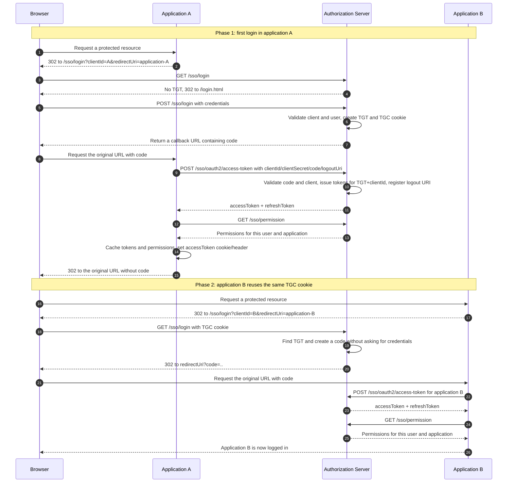
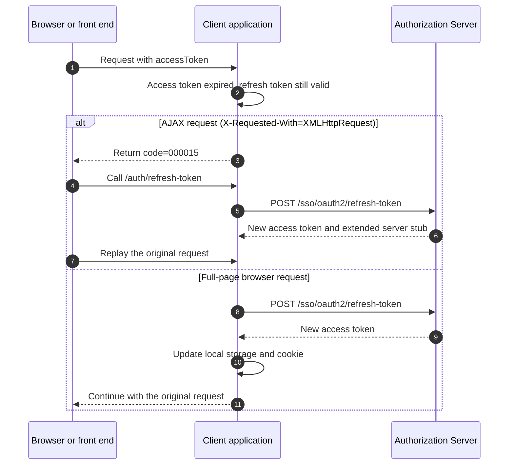
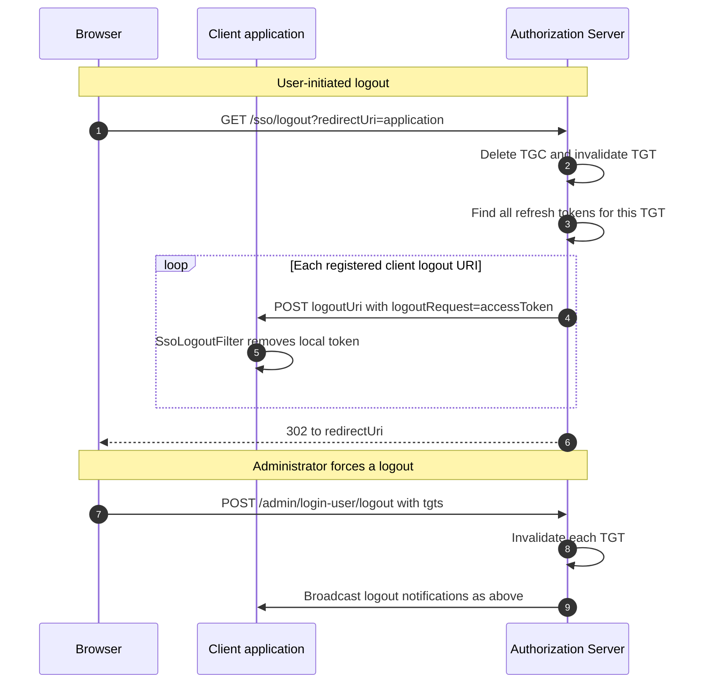

# Architecture and Protocol

**English** | [中文](architecture.md)

## 1. Roles and credential model

| Credential | Stored at | Default lifetime | Purpose |
| --- | --- | --- | --- |
| `TGT` (global session) | Server cookie named `TGC` | 7200s (`smart.sso.server.timeout`) | The user's authorization-server session and the anchor for single sign-on and logout. |
| `code` (authorization code) | Server | 600s (`code-timeout`), **one-time use** | Temporary credential exchanged for tokens. |
| `accessToken` | Client storage plus browser cookie/header | 1800s (`access-token-timeout`) | Lets the client validate the user locally without calling the server. |
| `refreshToken` | Client storage | 7200s (`timeout`) | Used to renew the access token. |

- Tokens are issued per `(TGT, clientId)`. A user has independent tokens in applications A and B, so one application
  cannot use another application's token.
- When a client exchanges a code, it also fetches and caches the user's `TokenPermission` snapshot for that application.
  Permission changes take effect after a new login or token refresh.

## 2. Single sign-on sequence

The sequence below shows a first login in application A followed by a password-free login in application B.



1. The client filter sees no local token and redirects the browser to `/sso/login?clientId=...&redirectUri=...`.
2. Without a `TGT`, the server redirects to `/login.html`; with an existing `TGT`, it skips the login page.
3. `POST /sso/login` validates the client and user, then creates or reuses the `TGT` and writes the cookie.
4. The server creates a one-time code and redirects to `redirectUri?code=...`.
5. The client exchanges the code at `/sso/oauth2/access-token`, while the server validates both the code and client
   identity and records the client's logout URI.
6. The client fetches `/sso/permission` and caches the application-specific permission set.
7. The client removes the `code` from the browser URL and serves the original resource using local token validation.

## 3. Token renewal



When the access token has expired but the refresh token is still valid, the client chooses the behavior by request type:

| Request type | Behavior |
| --- | --- |
| AJAX request with `X-Requested-With: XMLHttpRequest` | Return `{"code":"000015"}`. The front end refreshes and replays the request. |
| Full-page browser request | Refresh on the server side, update the local token and cookie, and continue transparently. |

## 4. Single logout



1. A client sends the browser to `/sso/logout?redirectUri=...`.
2. The server revokes every token associated with the user's `TGT`.
3. The server calls each registered `logoutUri`; `SsoLogoutFilter` clears the client token at the configured path
   (`smart.sso.logout-path`, default `/logout`).
4. The browser returns to `redirectUri`.

Forced logout from **Session Management** uses the same invalidation and callback mechanism.

## 5. Permission model

- Permissions are isolated by application in `sso_permission.app_id`. `type` is `menu` or `function`; `code` is the
  stable permission code, while menu navigation is stored separately in `url`.
- `smart.sso.url-patterns` defines the protected range. `exclude-urls` takes precedence and bypasses SSO completely.
- `SsoLoginFilter` checks login state. `SsoAuthorizationInterceptor` reads `@RequiresPermission` and checks the stable
  permission-code set in the token.
- A protected method without `@RequiresPermission` is allowed after login. A missing permission returns
  `{"code":"000020"}` and HTTP 403.
- A stable permission code may protect multiple Controller methods. Permission changes require a new login or token
  refresh to update the snapshot.
- Admin buttons use `permission="stable-code"` for display control; server-side annotations remain the security boundary.

## 6. Same-origin mode and the server as a client

`smart-sso-server` is also registered as a client, so it can call its own authorization endpoints. The address rules are:

| Configuration | Behavior |
| --- | --- |
| `server-url` configured | Treat the app as an independent client and use the absolute URL for redirects and calls. |
| Empty `server-url`, app contains the server | **Same-origin mode**: browser redirects use relative paths, and server-to-server calls use the derived `http(s)://127.0.0.1:{port}{context-path}` address. |
| Empty `server-url`, app is not the server | **Startup fails** to avoid silently redirecting to the client's own `/sso/login`. |

Set `smart.sso.internal-server-url` when the derived local address is not suitable.

## 7. Distributed deployment

Add the Redis modules so multiple instances can share credentials and permissions:

```xml
<!-- Server-side Redis support -->
<dependency>
  <groupId>io.github.openjoe</groupId>
  <artifactId>smart-sso-starter-server-redis</artifactId>
</dependency>
<!-- Client-side Redis support -->
<dependency>
  <groupId>io.github.openjoe</groupId>
  <artifactId>smart-sso-starter-client-redis</artifactId>
</dependency>
```

Without Redis, `Local*Manager` and `Local*Storage` provide in-memory storage for single-instance deployments and local development.
